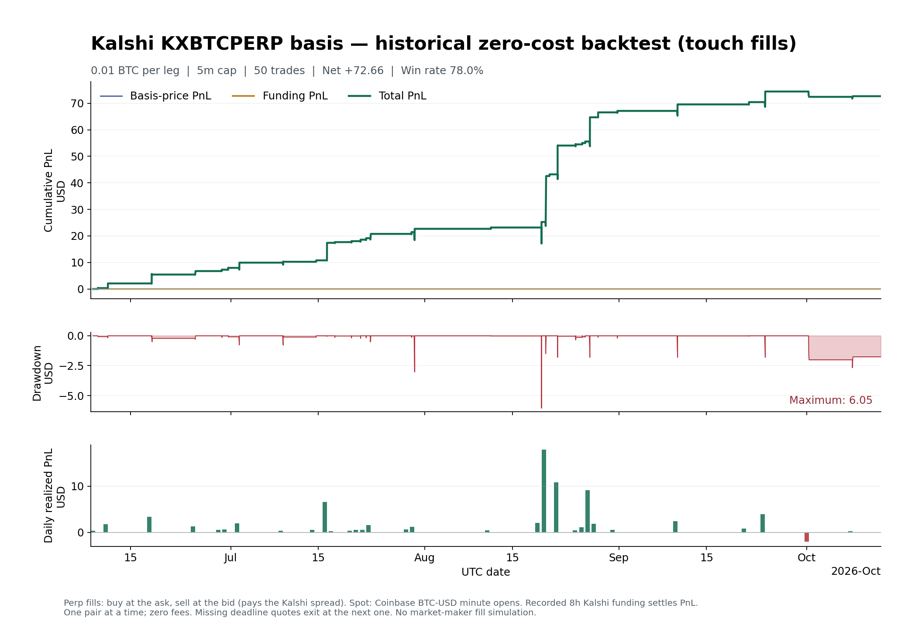

# Kalshi BTC basis backtest (touch fills)

**Total PnL: +72.659700 USD**, consisting of
+72.659700 basis-price PnL and +0.000000 funding cash flows.

| Metric | Result |
|---|---:|
| UTC data start | 2026-06-09T00:00:00Z |
| UTC data end | 2026-10-12T20:07:00Z |
| Perp fill price | buy at the ask, sell at the bid (pays the Kalshi spread) |
| Entry threshold | ±8 bps |
| Exit target | ±1 bps |
| Exit on first profit | no |
| Quantity per leg | 0.01 BTC |
| Maximum holding period | 5 minutes |
| Average measured holding period | 12.840 minutes |
| Longest measured trade | 115 minutes |
| Mean Kalshi spread at entry | 6.786 bps |
| Trading/carry costs | 0 bps |
| Funding events crossed | 0 |
| Trades | 50 |
| Win rate | 78.00% |
| Mean trade PnL | +20.524461 bps |
| Maximum observed minute mark-to-market drawdown | 6.047000 USD |
| Matched minute observations | 178,994 |
| Missing matched minutes inside covered span | 2,214 |
| Kalshi minutes dropped for empty/crossed quotes | 45 |
| Final pairs closed early at data end | 0 |
| Late exits (deadline quote missing) | 5 |

None of the measured trades crossed a funding boundary.

| Direction | Trades | Basis-price PnL | Funding PnL | Total PnL |
|---|---:|---:|---:|---:|
| Buy basis | 9 | +20.602900 | +0.000000 | +20.602900 |
| Sell basis | 41 | +52.056800 | +0.000000 | +52.056800 |

## Rule tested

The same rule as `Primary-Market-Model/results/basis-both-5m`, with the Kalshi
perp in place of Coinbase `BTC-PERP-INTX`. Check each available minute open, with
`basis = 10,000 * (perp / spot - 1)`:

- Buy basis: **long perp / short spot** when basis is below **-8 bps**.
- Sell basis: **short perp / long spot** when basis is above **+8 bps**.

Each entry also requires positive theo edge above 0 bps:
the basis move to the **-1 / +1 bps** exit target, minus funding the
side would pay if an 8-hour Kalshi funding boundary falls inside the
5-minute window (the last recorded rate is persisted).

Close at the first available minute with positive total PnL (including funding)
if profit exits are enabled; disabled in this run,
when long basis reaches -1 bps or higher or
short basis reaches +1 bps or lower,
or at the 5-minute deadline.
Never close and reopen in the same minute. Hold one equal-BTC pair at a time.
No future prices select an entry. A final open pair is closed at data end.

If no matched price exists at the exact deadline, the pair closes at the next
observed minute (LATE_TIMEOUT). Trades are never dropped based on whether later
data exists, so the sample is not conditioned on future information.

| Exit reason | Trades |
|---|---:|
| CONVERGED | 11 |
| LATE_TIMEOUT | 5 |
| TIMEOUT | 34 |

### Worst trades

| Entry (UTC) | Side | Basis entry → exit (bps) | Entry spread (bps) | Net PnL | Exit |
|---|---|---|---:|---:|---|
| 2026-10-01T07:50:00Z | Sell | +66.4 → +90.4 | 18.2 | -2.0080 | LATE_TIMEOUT |
| 2026-06-18T09:15:00Z | Sell | +8.1 → +9.3 | 0.2 | -0.0807 | TIMEOUT |
| 2026-06-18T09:57:00Z | Sell | +9.4 → +10.5 | 1.1 | -0.0730 | TIMEOUT |
| 2026-06-18T10:21:00Z | Sell | +9.9 → +11.0 | 1.3 | -0.0690 | TIMEOUT |
| 2026-06-18T09:45:00Z | Sell | +9.4 → +10.1 | 0.2 | -0.0467 | TIMEOUT |

## Differences from the primary run

| | Primary (Coinbase INTX) | This run (Kalshi) |
|---|---|---|
| Perp price | Trade candle open | Kalshi bid/ask at the minute open (touch) |
| Funding | Hourly, premium-TWAP forecast | Every 8 hours, last rate persisted |
| Entry check skipped without 60 min TWAP history | Yes | No (TWAP not used) |
| Candle timestamp | Start of minute | Kalshi `end_period_ts` shifted back 60s to the start |

## Realized accounting

`price_PnL = direction * q * [(perp_exit - perp_entry) - (spot_exit - spot_entry)]`

`funding_PnL = -direction * q * sum(recorded_mark * recorded_rate)`

Direction is +1 for buy basis and -1 for sell basis. Funding payments in
`(entry, exit]` count. Kalshi prices are quoted per 0.0001 BTC and are scaled
to USD per BTC. Trade bps divide net PnL by entry spot notional; their mean is
not an account return.

## Data and practical limits

Perp: Kalshi `KXBTCPERP` 1-minute bid/ask candles. Spot: Coinbase `BTC-USD`
minute candle opens, assumed executable with no spread. Funding: recorded
Kalshi 8-hour rates and marks. The Kalshi quote at the minute open and the
first spot trade of the minute are not exactly simultaneous. No fees, spot
spread, slippage, depth, borrow, margin, or liquidation is simulated; touch
fills assume the full size is available at the top of the book. Missing or
crossed Kalshi quotes are dropped, not forward-filled. This is a historical
zero-cost signal test, not locked arbitrage.

## Audit files

- [Trade ledger](trades.csv)
- [Minute mark-to-market equity](equity.csv)
- [Machine-readable summary](summary.json)
- [Vector chart](pnl.svg)
