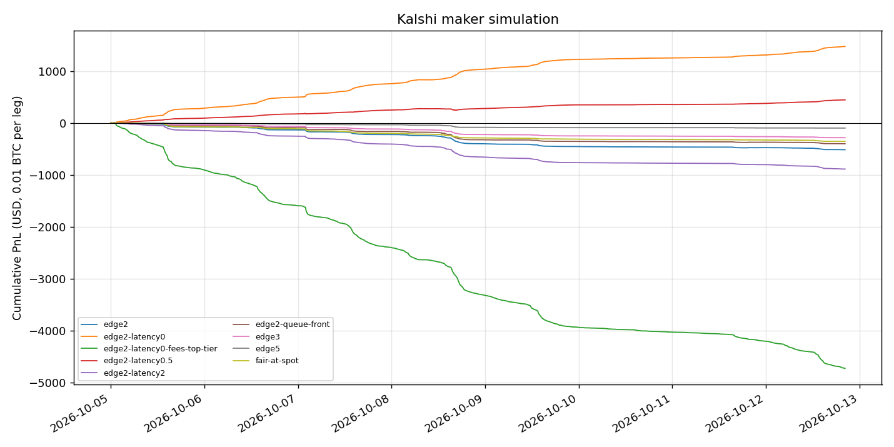

# Kalshi maker simulation

UTC 2026-10-05T00:00:00Z through 2026-10-12T20:19:22Z, Kalshi `KXBTCPERP` tick trades vs Coinbase `BTC-USD` 1-second spot. Rerun with `make maker-report`.

Settings shared by every run: `exit_bps=0`, `center_bps=0`, `center_minutes=60`, `holding_minutes=5`, `sides=both`.

| Run | edge_bps | center | queue | quote_latency_s | hedge_latency_s | perp_maker_fee_bps | perp_taker_fee_bps | spot_fee_bps | Trades | Win % | Captured bps | Hedge slip bps | Fees | Net PnL | Max DD |
|---|---|---|---|---|---|---|---|---|---:|---:|---:|---:|---:|---:|---:|
| edge2 | 2 | trailing_ema | back | 1 | 1 | 0 | 0 | 0 | 10181 | 41.0 | +1.97 | +2.15 | +0.00 | **-516.39** | 516.69 |
| edge2-latency0 | 2 | trailing_ema | back | 0 | 0 | 0 | 0 | 0 | 8036 | 97.2 | +1.88 | +0.00 | +0.00 | **+1472.62** | 1.52 |
| edge2-latency0-fees-top-tier | 2 | trailing_ema | back | 0 | 0 | 0.6 | 2.6 | 4 | 8036 | 0.3 | +1.88 | +0.00 | -6199.82 | **-4727.19** | 4727.19 |
| edge2-latency0.5 | 2 | trailing_ema | back | 0.5 | 0.5 | 0 | 0 | 0 | 9390 | 69.8 | +1.93 | +1.28 | +0.00 | **+443.35** | 29.54 |
| edge2-latency2 | 2 | trailing_ema | back | 2 | 2 | 0 | 0 | 0 | 11199 | 30.9 | +2.03 | +2.44 | +0.00 | **-888.39** | 888.51 |
| edge2-queue-front | 2 | trailing_ema | front | 1 | 1 | 0 | 0 | 0 | 11828 | 46.6 | +1.97 | +2.04 | +0.00 | **-401.27** | 401.45 |
| edge3 | 3 | trailing_ema | back | 1 | 1 | 0 | 0 | 0 | 3583 | 36.8 | +2.84 | +3.25 | +0.00 | **-285.18** | 285.33 |
| edge5 | 5 | trailing_ema | back | 1 | 1 | 0 | 0 | 0 | 643 | 32.7 | +4.33 | +5.51 | +0.00 | **-99.56** | 100.01 |
| fair-at-spot | 2 | fixed | back | 1 | 1 | 0 | 0 | 0 | 6531 | 38.6 | +2.25 | +1.13 | +0.00 | **-355.35** | 356.25 |

**Captured bps**: how far from Coinbase spot the perp fill was, in our favour (sold rich / bought cheap).
**Hedge slip bps**: how far spot moved against us between the price we quoted off and the spot hedge.
When slip is about as large as captured, fills are adverse selection: we are filled because our quote is stale.

## Assumptions

- **Fills**: Kalshi publishes trades, not the order book. A resting order fills when takers trade at its price (`queue=front`, optimistic) or through it (`queue=back`, conservative). Fills accumulate to the full size.
- **Best bid/ask**: the last seller-initiated and buyer-initiated prints. Quotes are post-only and never cross them.
- **Our orders change nothing**: no other trader reacts to our quotes, and taker flow is the same with us in the book.
- **Latency**: quotes use spot known `quote_latency_s` before each print; the spot hedge executes at the spot price `hedge_latency_s` after the fill. Spot is 1-second candles, so delays are rounded to whole seconds.
- **Spot**: unlimited size at the last trade price; no spot spread beyond `spot_fee_bps`.
- **Exits**: a post-only order at fair +/- `exit_bps`; at the holding deadline, cross the Kalshi spread and pay the taker fee. Funding is charged on positions held through an 8-hour settlement.
- **One position at a time**, `quantity_btc` per leg. No margin, borrow, or liquidation.
